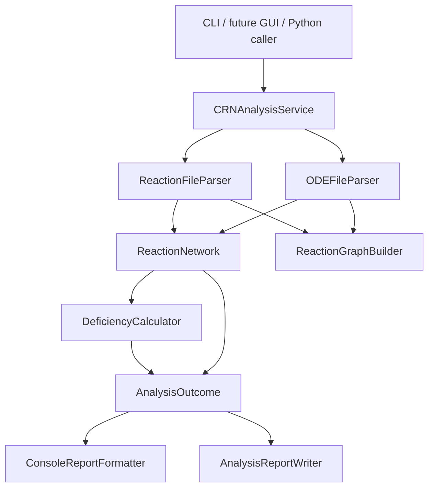
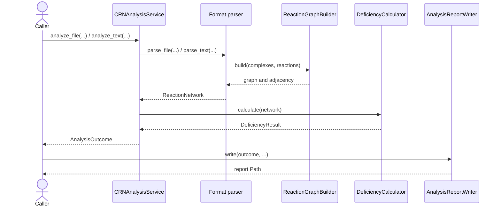

# Developer and Operations Guide

This document describes the software architecture, module responsibilities,
extension points, testing, packaging, and release workflow. User-facing setup
and examples belong in the repository `README.md`; mathematical methodology
belongs in `scientific_methods.md`.

## Contents

- [Architecture](#architecture)
- [Processing flows](#processing-flows)
- [Class diagram](#class-diagram)
- [Package modules](#package-modules)
- [Method reference](#method-reference)
- [Public API policy](#public-api-policy)
- [Adding an input format](#adding-an-input-format)
- [GUI integration](#gui-integration)
- [Error boundaries](#error-boundaries)
- [Requirements](#requirements)
- [Local development](#local-development)
- [Packaging](#packaging)
- [Version and release checklist](#version-and-release-checklist)

## Architecture

The application is divided into domain, parsing, graph, calculation,
orchestration, and presentation boundaries:



The parser and calculation layers do not read from standard input or write to
standard output. Only the CLI adapter in `orchestrator.main()` performs console
interaction. A GUI should call `CRNAnalysisService` directly.

## Processing flows



## Class diagram


## Package modules

### `crn_models.py`

Contains the normalized domain model:

- `Complex`: one indexed complex and its species coefficients.
- `Reaction`: a directed edge referencing source and target complex indices.
- `ReactionGraph`: a graph view reusing network complex and reaction objects.
- `ReactionNetwork`: reactions, complexes, graph, weighted adjacency, and input
  parameter metadata.

Complex compositions are stored once. Reaction and graph records use indices or
shared object references to avoid duplicating stoichiometric dictionaries.

### `parser_utils.py`

Contains shared parser infrastructure:

- `ParserError`
- `SectionParser`
- `AssignmentParser`
- generic `BaseFileParser`

`BaseFileParser` centralizes UTF-8 file loading, dependency injection, section
handling, assignment parsing, unresolved-value policy creation, and graph
builder creation.

### `parser_policies.py`

Implements the strategy pattern for unresolved values:

- `SymbolicValuePolicy`
- `StrictValuePolicy`
- `UnitValuePolicy`
- `UnresolvedValuePolicyFactory`

New policies should implement `UnresolvedValuePolicy` and be registered with
the factory. Defined rate constants must remain strictly positive because zero
is reserved as the no-edge adjacency value.

### `reaction_parser.py`

Contains `.react`-specific grammar, complex parsing, and reaction construction.
`ReactionFileParser` returns a typed `ReactionNetwork`; `parse_reaction_file`
and `parse_reaction_text` return normalized dictionaries.

### `ode_parser.py`

Contains ODE grammar, term models, mass-action validation, canonical reaction
grouping, and ODE warnings. `ODEFileParser` returns `ODEParseResult`, which
contains the source equations, reconstructed network, and warnings.

### `graph_utils.py`

`ComplexRegistry` assigns stable indices in first-appearance order.
`ReactionGraphBuilder` constructs the graph view and weighted symmetric
adjacency matrix. Multiple paths occupy a list within one matrix cell.

### `deficiency_utils.py`

`DeficiencyCalculator` validates complex references, obtains undirected
linkage classes with union-find, builds reaction vectors, computes exact or
symbolic ranks with SymPy, and returns global and per-class results.

### `orchestrator.py`

Contains application-level coordination:

- `CRNAnalysisService`: file/text parsing and deficiency calculation.
- `AnalysisOutcome`: UI-independent aggregate result.
- `ConsoleReportFormatter`: human-readable presentation.
- `AnalysisReportWriter`: structured JSON persistence.
- `main`: argparse and interactive-console adapter.

## Method reference

The signatures below reflect the current source. `self` and `cls` are omitted
from parameter tables. “None directly” means the method performs no explicit
validation, although built-in exceptions may still surface from invalid Python
objects. Methods beginning with `_` are internal and may change without a
compatibility guarantee.

### `crntanalysis.__init__`

This module defines no functions or methods. It re-exports the stable parser
and deficiency APIs and defines `__version__`.

### `crn_models.py`

#### `Complex.to_dict` — public

```python
def to_dict(self) -> dict
```

Serializes an indexed complex.

| Element | Type | Default | Description |
|---|---|---:|---|
| Return | `dict` | — | Index, label, and a copy of the species mapping. |
| Raises | — | — | None directly. |

#### `Reaction.source`, `Reaction.target`, and `Reaction.weight` — public properties

```python
@property
def source(self) -> int

@property
def target(self) -> int

@property
def weight(self) -> Weight
```

| Element | Type | Default | Description |
|---|---|---:|---|
| `source` return | `int` | — | Source-complex index. |
| `target` return | `int` | — | Target-complex index. |
| `weight` return | `float \| str` | — | Numerical rate when resolved; otherwise the rate symbol. |
| Raises | — | — | None. |

#### `Reaction.to_dict` — public

```python
def to_dict(self) -> dict
```

| Element | Type | Default | Description |
|---|---|---:|---|
| Return | `dict` | — | Normalized reaction edge, rate metadata, and weight. |
| Raises | — | — | None. |

#### `ReactionGraph.to_dict` — public

```python
def to_dict(self) -> dict
```

| Element | Type | Default | Description |
|---|---|---:|---|
| Return | `dict` | — | Node indices and reaction indices without duplicating domain data. |
| Raises | — | — | None directly. |

#### `ReactionNetwork.complex_index` — public property

```python
@property
def complex_index(self) -> Dict[str, int]
```

| Element | Type | Default | Description |
|---|---|---:|---|
| Return | `dict[str, int]` | — | Complex label-to-index lookup. |
| Raises | — | — | None directly. |

#### `ReactionNetwork.reactant_complex` — public

```python
def reactant_complex(self, reaction: Reaction) -> Complex
```

| Element | Type | Default | Description |
|---|---|---:|---|
| `reaction` | `Reaction` | required | Reaction whose source is requested. |
| Return | `Complex` | — | Indexed source complex. |
| Raises | `IndexError` | — | Source index is outside the complex list. |

#### `ReactionNetwork.product_complex` — public

```python
def product_complex(self, reaction: Reaction) -> Complex
```

| Element | Type | Default | Description |
|---|---|---:|---|
| `reaction` | `Reaction` | required | Reaction whose target is requested. |
| Return | `Complex` | — | Indexed target complex. |
| Raises | `IndexError` | — | Target index is outside the complex list. |

#### `ReactionNetwork.to_dict` — public

```python
def to_dict(self) -> dict
```

| Element | Type | Default | Description |
|---|---|---:|---|
| Return | `dict` | — | Complete normalized, serializable network representation. |
| Raises | — | — | None directly. |

### `parser_utils.py`

#### `SectionParser.parse` — public

```python
def parse(self, text: str) -> Sections
```

| Element | Type | Default | Description |
|---|---|---:|---|
| `text` | `str` | required | Complete labeled input document. |
| Return | `dict[str, list[tuple[int, str]]]` | — | Lowercase section names mapped to numbered content rows. |
| Raises | — | — | None directly; unsectioned content is ignored. |

#### `AssignmentParser.parse` — public

```python
def parse(
    self,
    rows: Iterable[SectionRow],
    section_name: str,
    error_type: Type[ParserError] = ParserError,
) -> Dict[str, float]
```

| Element | Type | Default | Description |
|---|---|---:|---|
| `rows` | `Iterable[tuple[int, str]]` | required | Numbered assignment rows. |
| `section_name` | `str` | required | Human-readable name used in diagnostics. |
| `error_type` | `Type[ParserError]` | `ParserError` | Format-specific exception class. |
| Return | `dict[str, float]` | — | Parsed numeric assignments. |
| Raises | `error_type` | — | A row is not a valid `name = number` assignment. |

#### `BaseFileParser.__init__` — public constructor

```python
def __init__(
    self,
    unresolved: str = "symbolic",
    *,
    policy: Optional[UnresolvedValuePolicy] = None,
    section_parser: Optional[SectionParser] = None,
    assignment_parser: Optional[AssignmentParser] = None,
    graph_builder: Optional[ReactionGraphBuilder] = None,
) -> None
```

| Parameter | Type | Default | Description |
|---|---|---:|---|
| `unresolved` | `str` | `"symbolic"` | Policy name used when no policy object is injected. |
| `policy` | `UnresolvedValuePolicy \| None` | `None` | Custom missing-value strategy. |
| `section_parser` | `SectionParser \| None` | `None` | Custom section parser. |
| `assignment_parser` | `AssignmentParser \| None` | `None` | Custom assignment parser. |
| `graph_builder` | `ReactionGraphBuilder \| None` | `None` | Custom graph builder. |
| Return | `None` | — | Initializes shared dependencies. |
| Raises | `ValueError` | — | `unresolved` is not a registered policy. |

#### `BaseFileParser.parse_file` — public

```python
def parse_file(self, path: Union[str, Path]) -> ParsedResult
```

| Element | Type | Default | Description |
|---|---|---:|---|
| `path` | `str \| Path` | required | UTF-8 input file. |
| Return | `ParsedResult` | — | Concrete parser result. |
| Raises | `OSError`, `UnicodeError`, `ParserError` | — | File access, decoding, or parsing fails. |

#### `BaseFileParser.parse_sections` — public extension point

```python
def parse_sections(self, text: str) -> Sections
```

| Element | Type | Default | Description |
|---|---|---:|---|
| `text` | `str` | required | Complete source text. |
| Return | `Sections` | — | Parsed labeled sections. |
| Raises | — | — | None directly. |

#### `BaseFileParser.parse_assignments` — public extension point

```python
def parse_assignments(
    self, sections: Sections, section_key: str, display_name: str
) -> Dict[str, float]
```

| Element | Type | Default | Description |
|---|---|---:|---|
| `sections` | `Sections` | required | Parsed document sections. |
| `section_key` | `str` | required | Normalized lookup key. |
| `display_name` | `str` | required | Diagnostic section label. |
| Return | `dict[str, float]` | — | Parsed assignments, or an empty mapping for a missing section. |
| Raises | parser-specific `ParserError` | — | An assignment is malformed. |

#### `BaseFileParser.parse_text` — public abstract method

```python
@abstractmethod
def parse_text(self, text: str) -> ParsedResult
```

| Element | Type | Default | Description |
|---|---|---:|---|
| `text` | `str` | required | Complete input document. |
| Return | `ParsedResult` | — | Concrete format result. |
| Raises | `NotImplementedError` | — | Called on a subclass without an implementation. |

### `parser_policies.py`

#### `_positive_rate` — private

```python
def _positive_rate(symbol: str, value: Optional[float]) -> Optional[float]
```

| Element | Type | Default | Description |
|---|---|---:|---|
| `symbol` | `str` | required | Rate-constant name for diagnostics. |
| `value` | `float \| None` | required | Resolved value or missing marker. |
| Return | `float \| None` | — | The validated input value. |
| Raises | `UnresolvedValueError` | — | A defined rate is zero or negative. |

#### `UnresolvedValuePolicy.coefficient` and `.rate` — public abstract methods

```python
@abstractmethod
def coefficient(self, symbol: str, values: Mapping[str, float]) -> Union[float, str]

@abstractmethod
def rate(self, symbol: str, values: Mapping[str, float]) -> Optional[float]
```

| Element | Type | Default | Description |
|---|---|---:|---|
| `symbol` | `str` | required | Referenced parameter name. |
| `values` | `Mapping[str, float]` | required | Defined values. |
| `coefficient` return | `float \| str` | — | Resolved value or retained symbol. |
| `rate` return | `float \| None` | — | Resolved rate or missing marker. |
| Raises | `NotImplementedError` | — | Invoked without a concrete strategy. |

#### Concrete policy `.coefficient` and `.rate` — public

```python
def coefficient(self, symbol: str, values: Mapping[str, float])
def rate(self, symbol: str, values: Mapping[str, float])
```

These signatures apply to `SymbolicValuePolicy`, `StrictValuePolicy`, and
`UnitValuePolicy`.

| Policy | Missing coefficient | Missing rate | Exceptions |
|---|---|---|---|
| `SymbolicValuePolicy` | Returns `symbol`. | Returns `None`. | Nonpositive defined rate raises `UnresolvedValueError`. |
| `StrictValuePolicy` | Raises. | Raises. | `UnresolvedValueError` for missing required values. |
| `UnitValuePolicy` | Returns `1.0`. | Returns `1.0`. | Nonpositive defined rate raises `UnresolvedValueError`. |

#### `UnresolvedValuePolicyFactory.create` — public

```python
@classmethod
def create(cls, name: str) -> UnresolvedValuePolicy
```

| Element | Type | Default | Description |
|---|---|---:|---|
| `name` | `str` | required | `symbolic`, `error`, or `one`. |
| Return | `UnresolvedValuePolicy` | — | New concrete policy instance. |
| Raises | `ValueError` | — | Policy name is unknown. |

### `graph_utils.py`

#### `ComplexRegistry.__init__` — public constructor

```python
def __init__(self) -> None
```

| Element | Type | Default | Description |
|---|---|---:|---|
| Return | `None` | — | Creates an empty identity map. |
| Raises | — | — | None. |

#### `ComplexRegistry._key` — private

```python
@staticmethod
def _key(species: Mapping[str, Scalar]) -> tuple
```

| Element | Type | Default | Description |
|---|---|---:|---|
| `species` | `Mapping[str, Scalar]` | required | Complex composition. |
| Return | `tuple` | — | Order-independent canonical identity key. |
| Raises | — | — | None for supported scalar values. |

#### `ComplexRegistry._label` — private

```python
@staticmethod
def _label(species: Mapping[str, Scalar]) -> str
```

| Element | Type | Default | Description |
|---|---|---:|---|
| `species` | `Mapping[str, Scalar]` | required | Complex composition. |
| Return | `str` | — | Human-readable complex label; `0` for an empty complex. |
| Raises | — | — | None for supported scalar values. |

#### `ComplexRegistry.register` — public

```python
def register(self, species: Mapping[str, Scalar]) -> int
```

| Element | Type | Default | Description |
|---|---|---:|---|
| `species` | `Mapping[str, Scalar]` | required | Complex to register. |
| Return | `int` | — | Existing or newly assigned stable index. |
| Raises | — | — | None for supported scalar values. |

#### `ComplexRegistry.complexes` — public property

```python
@property
def complexes(self) -> List[Complex]
```

| Element | Type | Default | Description |
|---|---|---:|---|
| Return | `list[Complex]` | — | Shallow copy of registered complexes. |
| Raises | — | — | None. |

#### `ReactionGraphBuilder.build` — public

```python
def build(
    self, complexes: List[Complex], reactions: List[Reaction]
) -> Tuple[ReactionGraph, List[List[AdjacencyCell]]]
```

| Element | Type | Default | Description |
|---|---|---:|---|
| `complexes` | `list[Complex]` | required | Indexed graph nodes. |
| `reactions` | `list[Reaction]` | required | Directed weighted edges. |
| Return 1 | `ReactionGraph` | — | Graph view reusing supplied objects. |
| Return 2 | `list[list[AdjacencyCell]]` | — | Symmetric weighted adjacency matrix. |
| Raises | `IndexError` | — | A reaction contains an invalid complex index. |

#### `ReactionGraphBuilder._add_weight` — private

```python
@staticmethod
def _add_weight(cell: AdjacencyCell, weight: Weight) -> AdjacencyCell
```

| Element | Type | Default | Description |
|---|---|---:|---|
| `cell` | `AdjacencyCell` | required | Existing zero, scalar, symbol, or list. |
| `weight` | `float \| str` | required | New path weight. |
| Return | `AdjacencyCell` | — | Scalar first weight or accumulated weight list. |
| Raises | — | — | None. |

### `reaction_parser.py`

#### `ComplexParser.__init__` — public constructor

```python
def __init__(self, policy: UnresolvedValuePolicy) -> None
```

| Element | Type | Default | Description |
|---|---|---:|---|
| `policy` | `UnresolvedValuePolicy` | required | Coefficient-resolution strategy. |
| Return | `None` | — | Initializes the complex parser. |
| Raises | — | — | None. |

#### `ComplexParser.parse` — public within the parser layer

```python
def parse(
    self,
    expression: str,
    coefficient_values: Mapping[str, float],
    line_number: int,
) -> Dict[str, Scalar]
```

| Element | Type | Default | Description |
|---|---|---:|---|
| `expression` | `str` | required | One complex expression. |
| `coefficient_values` | `Mapping[str, float]` | required | Defined symbolic coefficients. |
| `line_number` | `int` | required | Source location for diagnostics. |
| Return | `dict[str, Scalar]` | — | Normalized species-to-coefficient mapping. |
| Raises | `ReactionParseError` | — | Complex is empty/malformed, negative, or has uncombinable symbolic duplicates. |

#### `ReactionFileParser.__init__` — public constructor

```python
def __init__(
    self,
    unresolved: str = "symbolic",
    *,
    policy: Optional[UnresolvedValuePolicy] = None,
    section_parser: Optional[SectionParser] = None,
    assignment_parser: Optional[AssignmentParser] = None,
    graph_builder: Optional[ReactionGraphBuilder] = None,
) -> None
```

| Parameter | Type | Default | Description |
|---|---|---:|---|
| `unresolved` | `str` | `"symbolic"` | Missing-value policy name. |
| `policy` | `UnresolvedValuePolicy \| None` | `None` | Injected strategy. |
| `section_parser` | `SectionParser \| None` | `None` | Injected section parser. |
| `assignment_parser` | `AssignmentParser \| None` | `None` | Injected assignment parser. |
| `graph_builder` | `ReactionGraphBuilder \| None` | `None` | Injected graph builder. |
| Return | `None` | — | Initializes the parser. |
| Raises | `ValueError` | — | Policy name is unknown. |

#### `ReactionFileParser.parse_text` — public

```python
def parse_text(self, text: str) -> ReactionNetwork
```

| Element | Type | Default | Description |
|---|---|---:|---|
| `text` | `str` | required | Complete `.react` document. |
| Return | `ReactionNetwork` | — | Parsed and indexed network. |
| Raises | `ReactionParseError` | — | Required reactions are absent or content is malformed. |

#### `ReactionFileParser.parse_reaction` — public

```python
def parse_reaction(
    self,
    reaction_string: str,
    rate_constants: Optional[Mapping[str, float]] = None,
    coefficients: Optional[Mapping[str, float]] = None,
    *,
    index: int = 0,
    line_number: int = 1,
    registry: Optional[ComplexRegistry] = None,
) -> Reaction
```

| Parameter | Type | Default | Description |
|---|---|---:|---|
| `reaction_string` | `str` | required | One `reactants rate-> products` line. |
| `rate_constants` | `Mapping[str, float] \| None` | `None` | Defined rates. |
| `coefficients` | `Mapping[str, float] \| None` | `None` | Defined stoichiometric values. |
| `index` | `int` | `0` | Reaction index. |
| `line_number` | `int` | `1` | Diagnostic line number. |
| `registry` | `ComplexRegistry \| None` | `None` | Shared registry; a private one is created if absent. |
| Return | `Reaction` | — | Indexed reaction referencing registered complexes. |
| Raises | `ReactionParseError` | — | Syntax, coefficient, or rate validation fails. |

#### `parse_reaction_text` and `parse_reaction_file` — public functions

```python
def parse_reaction_text(text: str, unresolved: str = "symbolic") -> dict
def parse_reaction_file(path: Union[str, Path], unresolved: str = "symbolic") -> dict
```

| Element | Type | Default | Description |
|---|---|---:|---|
| `text` | `str` | required | Complete reaction document for the text function. |
| `path` | `str \| Path` | required | Reaction file for the file function. |
| `unresolved` | `str` | `"symbolic"` | Missing-value policy. |
| Return | `dict` | — | Normalized serialized network. |
| Raises | `OSError`, `UnicodeError`, `ReactionParseError`, `ValueError` | — | I/O, decoding, parsing, or policy selection fails. |

### `ode_parser.py`

#### `ODEEquation.to_dict` — public

```python
def to_dict(self) -> dict
```

| Element | Type | Default | Description |
|---|---|---:|---|
| Return | `dict` | — | Equation source, affected species, and parsed terms. |
| Raises | — | — | None directly. |

#### `ODEParseResult.to_dict` — public

```python
def to_dict(self) -> dict
```

| Element | Type | Default | Description |
|---|---|---:|---|
| Return | `dict` | — | Network data augmented with ODE equations and warnings. |
| Raises | — | — | None directly. |

#### `ODEFileParser.__init__` — public constructor

```python
def __init__(
    self,
    unresolved: str = "symbolic",
    *,
    policy: Optional[UnresolvedValuePolicy] = None,
    section_parser: Optional[SectionParser] = None,
    assignment_parser: Optional[AssignmentParser] = None,
    graph_builder: Optional[ReactionGraphBuilder] = None,
) -> None
```

Parameters, defaults, return, and policy-selection exceptions match
`ReactionFileParser.__init__`.

#### `ODEFileParser.parse_text` — public

```python
def parse_text(self, text: str) -> ODEParseResult
```

| Element | Type | Default | Description |
|---|---|---:|---|
| `text` | `str` | required | Complete `.ode` document. |
| Return | `ODEParseResult` | — | Equations, canonical network, and warnings. |
| Raises | `ODEParseError` | — | Equations are absent, malformed, or not ordinary mass action. |

#### `ODEFileParser._split_equation` — private

```python
def _split_equation(self, line_number: int, line: str) -> tuple
```

| Element | Type | Default | Description |
|---|---|---:|---|
| `line_number` | `int` | required | Source line number. |
| `line` | `str` | required | ODE assignment. |
| Return | `tuple` | — | Line number, source, derivative variable, and RHS. |
| Raises | `ODEParseError` | — | Derivative syntax is invalid. |

#### `ODEFileParser._species_names` — private

```python
@staticmethod
def _species_names(equation_specs) -> Dict[str, str]
```

| Element | Type | Default | Description |
|---|---|---:|---|
| `equation_specs` | iterable of equation tuples | required | Split equations. |
| Return | `dict[str, str]` | — | Case-folded derivative names to canonical species names. |
| Raises | — | — | None directly. |

#### `ODEFileParser._parse_equation` — private

```python
def _parse_equation(
    self, line_number: int, source: str, lhs: str, rhs: str,
    species_names: Mapping[str, str], values: Mapping[str, float]
) -> ODEEquation
```

| Parameter | Type | Default | Description |
|---|---|---:|---|
| `line_number` | `int` | required | Diagnostic location. |
| `source` | `str` | required | Original equation. |
| `lhs`, `rhs` | `str` | required | Derivative name and expression. |
| `species_names` | `Mapping[str, str]` | required | Canonical name map. |
| `values` | `Mapping[str, float]` | required | Coefficient definitions. |
| Return | `ODEEquation` | — | Parsed equation and terms. |
| Raises | `ODEParseError` | — | RHS expression or a term is malformed. |

#### `ODEFileParser._parse_term` — private

```python
def _parse_term(
    self, expression: str, affected: str, sign: int,
    species_names: Mapping[str, str], values: Mapping[str, float],
    line_number: int,
) -> ODETerm
```

| Parameter | Type | Default | Description |
|---|---|---:|---|
| `expression` | `str` | required | Unsigned multiplicative term. |
| `affected` | `str` | required | Derivative species. |
| `sign` | `int` | required | `1` or `-1`. |
| `species_names` | `Mapping[str, str]` | required | Canonical name map. |
| `values` | `Mapping[str, float]` | required | Defined coefficients. |
| `line_number` | `int` | required | Diagnostic location. |
| Return | `ODETerm` | — | Parsed kinetic contribution. |
| Raises | `ODEParseError` | — | Factor, exponent, or rate structure is invalid. |

#### `ODEFileParser._normalize_exponent` — private

```python
@staticmethod
def _normalize_exponent(exponent: Scalar, line_number: int) -> Scalar
```

| Element | Type | Default | Description |
|---|---|---:|---|
| `exponent` | `Scalar` | required | Numeric or symbolic exponent. |
| `line_number` | `int` | required | Diagnostic location. |
| Return | `int \| str` | — | Symbol or normalized integer exponent. |
| Raises | `ODEParseError` | — | A numerical exponent is negative or nonintegral. |

#### `ODEFileParser._build_network` — private

```python
def _build_network(
    self, equations: List[ODEEquation], values: Mapping[str, float]
) -> tuple
```

| Element | Type | Default | Description |
|---|---|---:|---|
| `equations` | `list[ODEEquation]` | required | Parsed coupled ODEs. |
| `values` | `Mapping[str, float]` | required | Coefficient definitions. |
| Return | `tuple[ReactionNetwork, set[str], set[str]]` | — | Network, used rates, and used exponent symbols. |
| Raises | `ODEParseError` | — | Rate resolution or product construction fails. |

#### `ODEFileParser._monomial_key` — private

```python
@staticmethod
def _monomial_key(reactant: Mapping[str, Scalar]) -> tuple
```

| Element | Type | Default | Description |
|---|---|---:|---|
| `reactant` | `Mapping[str, Scalar]` | required | Reactant monomial. |
| Return | `tuple` | — | Canonical grouping key. |
| Raises | — | — | None for supported scalar values. |

#### `ODEFileParser._products` — private

```python
@staticmethod
def _products(contribution: _ReactionContribution) -> Dict[str, Scalar]
```

| Element | Type | Default | Description |
|---|---|---:|---|
| `contribution` | `_ReactionContribution` | required | Grouped reaction vector and reactant. |
| Return | `dict[str, Scalar]` | — | Reconstructed product complex. |
| Raises | `ODEParseError` | — | Symbolic arithmetic is indeterminate or product stoichiometry is negative. |

#### `parse_ode_text` and `parse_ode_file` — public functions

```python
def parse_ode_text(text: str, unresolved: str = "symbolic") -> dict
def parse_ode_file(path: Union[str, Path], unresolved: str = "symbolic") -> dict
```

| Element | Type | Default | Description |
|---|---|---:|---|
| `text` | `str` | required | Complete ODE document for the text function. |
| `path` | `str \| Path` | required | ODE file for the file function. |
| `unresolved` | `str` | `"symbolic"` | Missing-value policy. |
| Return | `dict` | — | Serialized ODE result and network. |
| Raises | `OSError`, `UnicodeError`, `ODEParseError`, `ValueError` | — | I/O, decoding, parsing, or policy selection fails. |

### `deficiency_utils.py`

#### Result `.to_dict` methods — public

```python
def LinkageClassDeficiency.to_dict(self) -> dict
def DeficiencyResult.to_dict(self) -> dict
```

| Element | Type | Default | Description |
|---|---|---:|---|
| First return | `dict` | — | One class's indices, `n`, `s`, `l`, and deficiency. |
| Second return | `dict` | — | Global values, species, symbolic flag, and all class results. |
| Raises | — | — | None directly. |

#### `_DisjointSet.__init__`, `.find`, and `.union` — private

```python
def __init__(self, items: Iterable[int]) -> None
def find(self, item: int) -> int
def union(self, first: int, second: int) -> None
```

| Element | Type | Default | Description |
|---|---|---:|---|
| `items` | `Iterable[int]` | required | Initial complex indices. |
| `item` | `int` | required | Index whose representative is requested. |
| `first`, `second` | `int` | required | Indices to connect. |
| `find` return | `int` | — | Component representative with path compression. |
| Other return | `None` | — | Initialization or union side effect. |
| Raises | `KeyError` | — | An unknown index is requested. |

#### `DeficiencyCalculator.calculate` — public

```python
def calculate(self, network: ReactionNetwork) -> DeficiencyResult
```

| Element | Type | Default | Description |
|---|---|---:|---|
| `network` | `ReactionNetwork` | required | Network to analyze. |
| Return | `DeficiencyResult` | — | Global and per-linkage-class deficiencies. |
| Raises | `DeficiencyError` | — | Complex indices or reaction references are invalid. |

#### Deficiency validation helpers — private

```python
@staticmethod
def _complex_map(complexes: Sequence[Complex]) -> Dict[int, Complex]

@staticmethod
def _validate_reactions(
    reactions: Sequence[Reaction], complexes: Mapping[int, Complex]
) -> None
```

| Element | Type | Default | Description |
|---|---|---:|---|
| `complexes` | sequence or mapping | required | Indexed complex collection. |
| `reactions` | `Sequence[Reaction]` | required | Reactions to validate. |
| `_complex_map` return | `dict[int, Complex]` | — | Unique index lookup. |
| `_validate_reactions` return | `None` | — | Validation only. |
| Raises | `DeficiencyError` | — | Duplicate index or missing source/target. |

#### `DeficiencyCalculator._linkage_classes` — private

```python
@staticmethod
def _linkage_classes(
    network: ReactionNetwork, complexes: Mapping[int, Complex]
) -> List[Set[int]]
```

| Element | Type | Default | Description |
|---|---|---:|---|
| `network` | `ReactionNetwork` | required | Network providing edges. |
| `complexes` | `Mapping[int, Complex]` | required | Validated index map. |
| Return | `list[set[int]]` | — | Components ordered by their smallest index. |
| Raises | `KeyError` | — | Called without prior reference validation. |

#### Rank and vector helpers — private

```python
def _rank(
    self, reactions: Sequence[Reaction], complexes: Mapping[int, Complex],
    species: Sequence[str]
) -> int

def _reaction_vector(
    self, reaction: Reaction, complexes: Mapping[int, Complex],
    species: Sequence[str]
) -> List[Expr]

@staticmethod
def _sympy_scalar(value: Scalar) -> Expr

@staticmethod
def _contains_symbols(complexes: Sequence[Complex]) -> bool
```

| Element | Type | Default | Description |
|---|---|---:|---|
| `reactions` | `Sequence[Reaction]` | required | Rank/vector edge set. |
| `complexes` | `Mapping[int, Complex]` or sequence | required | Complex data. |
| `species` | `Sequence[str]` | required | Consistent vector coordinate order. |
| `reaction` | `Reaction` | required | Edge for one vector. |
| `value` | `Scalar` | required | Numeric or symbolic coefficient. |
| `_rank` return | `int` | — | Exact or generic symbolic matrix rank. |
| `_reaction_vector` return | `list[Expr]` | — | Product-minus-reactant vector. |
| `_sympy_scalar` return | `Expr` | — | SymPy rational or symbol. |
| `_contains_symbols` return | `bool` | — | Whether any complex coefficient is symbolic. |
| Raises | `KeyError`, SymPy exceptions | — | Invalid references or unsupported symbolic expressions. |

#### `calculate_deficiency` — public function

```python
def calculate_deficiency(network: ReactionNetwork) -> DeficiencyResult
```

| Element | Type | Default | Description |
|---|---|---:|---|
| `network` | `ReactionNetwork` | required | Network to analyze. |
| Return | `DeficiencyResult` | — | Result from a new `DeficiencyCalculator`. |
| Raises | `DeficiencyError` | — | Network validation fails. |

### `orchestrator.py`

#### `AnalysisOutcome.to_dict` — public

```python
def to_dict(self) -> dict
```

| Element | Type | Default | Description |
|---|---|---:|---|
| Return | `dict` | — | Input metadata, network, deficiency, and warnings. |
| Raises | — | — | None directly. |

#### `CRNAnalysisService.analyze_file` — public

```python
def analyze_file(
    self, path: Union[str, Path], *, input_format: str = "auto",
    unresolved: str = "symbolic"
) -> AnalysisOutcome
```

| Parameter | Type | Default | Description |
|---|---|---:|---|
| `path` | `str \| Path` | required | `.react` or `.ode` input path. |
| `input_format` | `str` | `"auto"` | Explicit format or suffix detection. |
| `unresolved` | `str` | `"symbolic"` | Missing-value policy. |
| Return | `AnalysisOutcome` | — | Parsed and analyzed outcome. |
| Raises | `OSError`, `UnicodeError`, `InputFormatError`, `ParserError`, `DeficiencyError` | — | Input, format, parsing, or analysis fails. |

#### `CRNAnalysisService.analyze_text` — public

```python
def analyze_text(
    self, text: str, *, input_format: str = "auto",
    unresolved: str = "symbolic", source: Optional[str] = None
) -> AnalysisOutcome
```

| Parameter | Type | Default | Description |
|---|---|---:|---|
| `text` | `str` | required | Complete input document. |
| `input_format` | `str` | `"auto"` | Explicit format or heading detection. |
| `unresolved` | `str` | `"symbolic"` | Missing-value policy. |
| `source` | `str \| None` | `None` | Optional display/source identifier. |
| Return | `AnalysisOutcome` | — | Parsed network, deficiency, and warnings. |
| Raises | `InputFormatError`, `ParserError`, `DeficiencyError` | — | Detection, parsing, or analysis fails. |

#### `CRNAnalysisService._resolve_format` — private

```python
def _resolve_format(
    self, requested: str, *, path: Optional[Path] = None,
    text: Optional[str] = None
) -> str
```

| Parameter | Type | Default | Description |
|---|---|---:|---|
| `requested` | `str` | required | `auto`, `react`, or `ode`. |
| `path` | `Path \| None` | `None` | Optional suffix source. |
| `text` | `str \| None` | `None` | Optional heading source. |
| Return | `str` | — | `react` or `ode`. |
| Raises | `InputFormatError` | — | Format is unsupported or cannot be inferred. |

#### `ConsoleReportFormatter.format` — public

```python
def format(self, outcome: AnalysisOutcome) -> str
```

| Element | Type | Default | Description |
|---|---|---:|---|
| `outcome` | `AnalysisOutcome` | required | Complete analysis result. |
| Return | `str` | — | Human-readable multiline report. |
| Raises | `KeyError` | — | Outcome contains inconsistent complex indices. |

#### `AnalysisReportWriter.write` — public

```python
def write(
    self, outcome: AnalysisOutcome,
    output_directory: Union[str, Path] = "output", *,
    filename: Optional[str] = None, extension: str = "analysis"
) -> Path
```

| Parameter | Type | Default | Description |
|---|---|---:|---|
| `outcome` | `AnalysisOutcome` | required | Result to serialize. |
| `output_directory` | `str \| Path` | `"output"` | Destination directory. |
| `filename` | `str \| None` | `None` | Optional stem; source-derived when absent. |
| `extension` | `str` | `"analysis"` | `analysis` or `output`. |
| Return | `Path` | — | Written report path. |
| Raises | `ValueError` | — | Extension is unsupported. |
| Raises | `OSError`, `TypeError` | — | Directory/write or JSON serialization fails. |

#### `AnalysisReportWriter._default_stem` — private

```python
@staticmethod
def _default_stem(source: Optional[str]) -> str
```

| Element | Type | Default | Description |
|---|---|---:|---|
| `source` | `str \| None` | required | Optional source path. |
| Return | `str` | — | Source-derived or generic report stem. |
| Raises | — | — | None directly. |

#### `_argument_parser` — private

```python
def _argument_parser() -> argparse.ArgumentParser
```

| Element | Type | Default | Description |
|---|---|---:|---|
| Return | `argparse.ArgumentParser` | — | Configured CLI parser. |
| Raises | — | — | None directly. |

#### `_interactive_input` — private

```python
def _interactive_input() -> tuple[str, str]
```

| Element | Type | Default | Description |
|---|---|---:|---|
| Return | `tuple[str, str]` | — | Source type (`file`/`text`) and entered value. |
| Raises | `InputFormatError` | — | No file or pasted content is supplied. |

#### `main` — public console entry point

```python
def main(argv: Optional[Sequence[str]] = None) -> int
```

| Element | Type | Default | Description |
|---|---|---:|---|
| `argv` | `Sequence[str] \| None` | `None` | Explicit arguments or process arguments. |
| Return | `int` | — | `0` on success; `1` for handled input/analysis errors. |
| Raises | `SystemExit` | — | Argparse handles invalid CLI syntax or help. |

### Other package modules

`visualiztion.py` currently defines no methods. It is not re-exported as public
API. Add its method contracts here when visualization functionality is
implemented.

## Public API policy

Stable user imports are re-exported from `crntanalysis.__init__`:

```python
from crntanalysis import ReactionFileParser, calculate_deficiency
```

Application-integration types are imported from their owning module:

```python
from crntanalysis.orchestrator import CRNAnalysisService
```

Internal helpers beginning with `_` are not public API. Before removing or
renaming a public symbol, update tests, documentation, and package versioning.

## Adding an input format

1. Implement a parser derived from `BaseFileParser`.
2. Return a `ReactionNetwork`, or a typed result that owns one.
3. Reuse `ComplexRegistry` and `ReactionGraphBuilder`.
4. Define a format-specific `ParserError` subclass.
5. Add format detection and routing to `CRNAnalysisService`.
6. Add unit tests for valid, invalid, symbolic, and incomplete input.
7. Document the scientific interpretation in `scientific_methods.md`.

## GUI integration

Do not call or capture `main()`. Use:

```python
service = CRNAnalysisService()
outcome = service.analyze_text(editor_text, input_format="react")
```

The GUI may render `AnalysisOutcome` directly or call `to_dict()`. Report
writing is optional and independent. Convert parser, I/O, and deficiency errors
into UI validation messages at the GUI boundary.

## Error boundaries

- `ParserError`: common parsing base error.
- `ReactionParseError`: malformed or inconsistent reaction input.
- `ODEParseError`: malformed or non-mass-action ODE input.
- `DeficiencyError`: invalid network structure for deficiency calculation.
- `InputFormatError`: unsupported or ambiguous orchestrator input.

Library code raises exceptions. The CLI catches expected user-facing failures,
prints a concise message to standard error, and returns status code `1`.

## Requirements

Runtime:

- Python 3.9+
- `sympy>=1.13,<2`

Build:

- PEP 517-compatible pip
- `setuptools>=61`
- `wheel`

Tests use the standard-library `unittest` package and require no extra testing
framework.

## Local development

```bash
python3 -m pip install -e .
python3 -m unittest -v
python3 -m py_compile setup.py crntanalysis/*.py
```

Run `git diff --check` before committing to detect whitespace errors. Keep
generated directories such as `build/`, `dist/`, `*.egg-info/`, and
`__pycache__/` out of source control.

## Packaging

`pyproject.toml` defines an isolated Setuptools build. `setup.py` supplies
package metadata, discovers `crntanalysis`, installs SymPy, requires Python
3.9+, and registers:

```text
crntanalysis = crntanalysis.orchestrator:main
```

Build source and wheel distributions with:

```bash
python3 -m pip install build
python3 -m build
```

Inspect `dist/`, then test installation in a clean virtual environment before
publishing.

## Version and release checklist

1. Update the version in `setup.py` and `crntanalysis/__init__.py`.
2. Run the full test and compilation commands.
3. Verify both `.react` and valid `.ode` CLI workflows.
4. Build source and wheel distributions.
5. Install the wheel into a clean environment.
6. Verify `import crntanalysis` and the `crntanalysis` console command.
7. Tag the corresponding source revision.

Keeping the version in two files is a current maintenance limitation. A future
packaging cleanup can move it to a single generated or declarative source.
