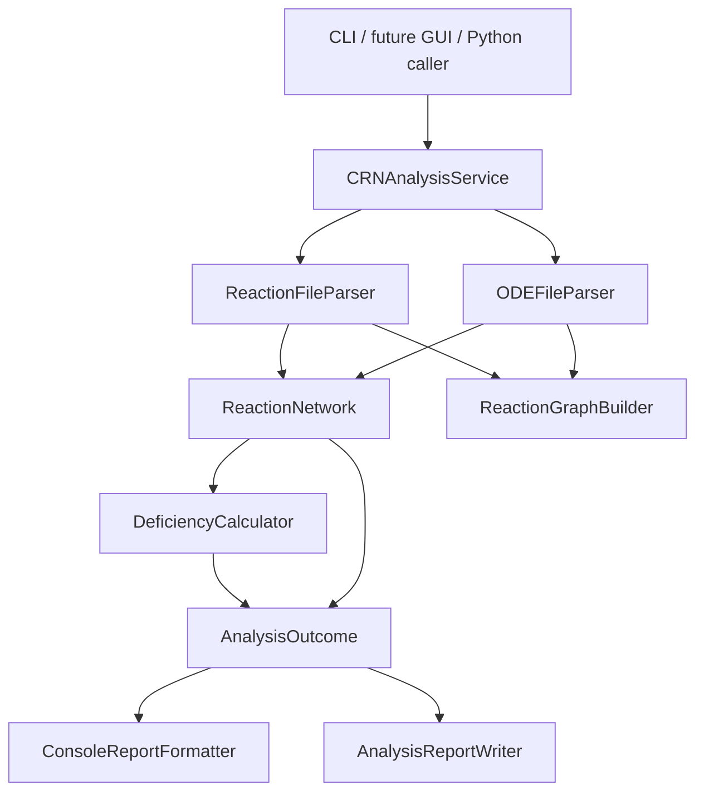
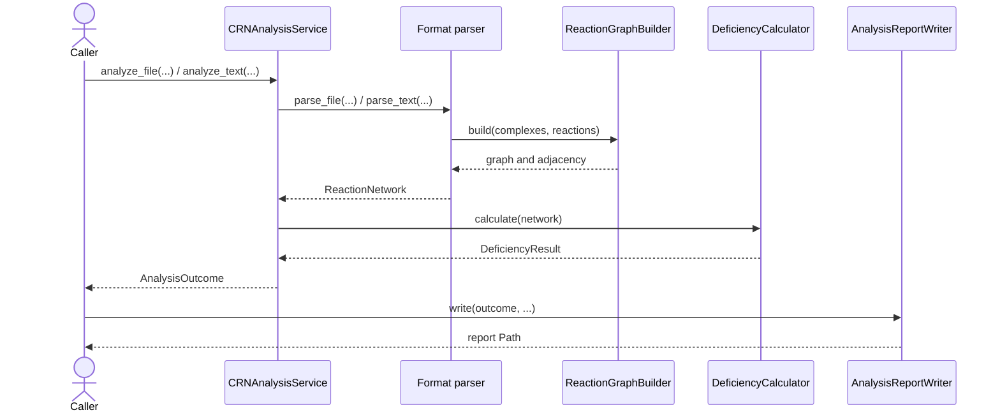
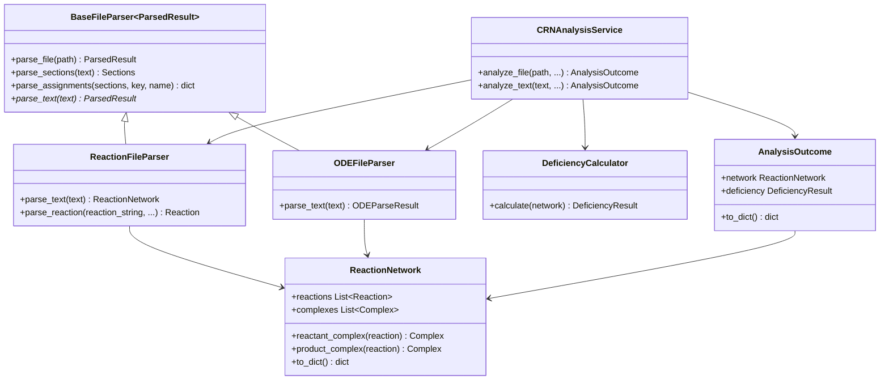
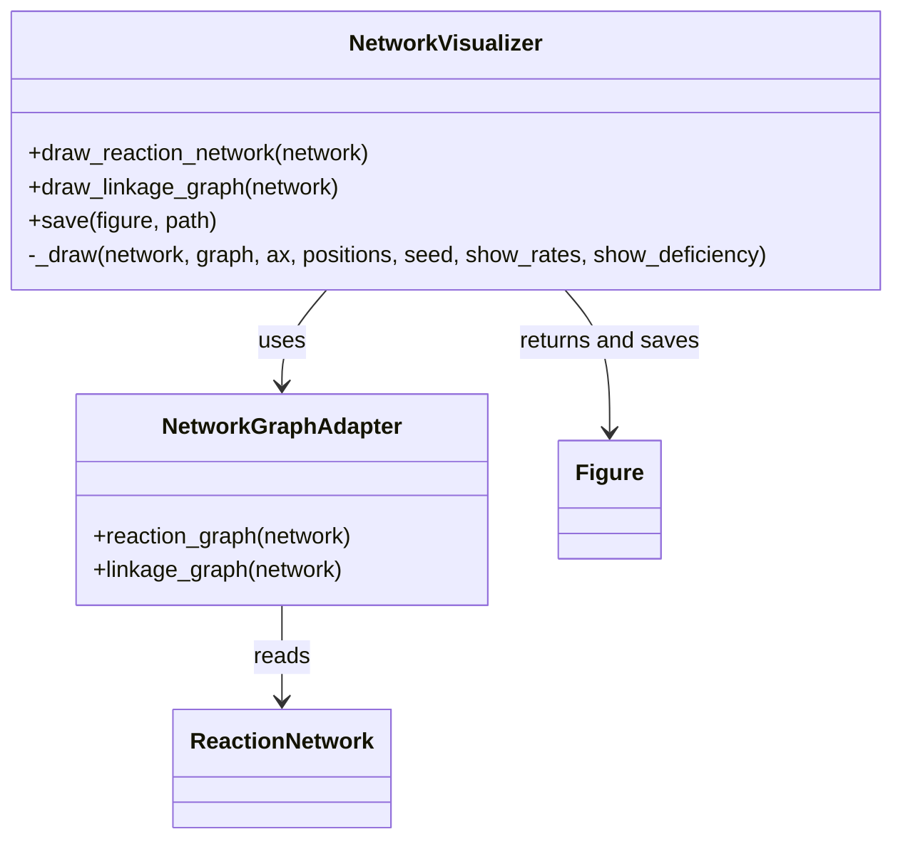

# Developer and Operations Guide

This document describes the software architecture, module responsibilities,
extension points, testing, packaging, and release workflow. User-facing setup
and examples belong in the repository `README.md`; mathematical methodology
belongs in `scientific_methods.md`.

## Contents

- [Project structure](#project-structure)
- [Architecture](#architecture)
- [Processing flows](#processing-flows)
- [Class diagram](#class-diagram)
- [Package modules](#package-modules)
- [Method reference](#method-reference)
- [Public API policy](#public-api-policy)
- [Adding an input format](#adding-an-input-format)
- [GUI integration](#gui-integration)
- [Error boundaries](#error-boundaries)
- [Requirements](#requirements)
- [Local development](#local-development)
- [Packaging](#packaging)
- [Version and release checklist](#version-and-release-checklist)

## Project structure

```text
CRN_Deficiency/
├── crntanalysis/                       # Installable Python package
│   ├── __init__.py                     # Package version and public API exports
│   ├── crn_models.py                   # Complex, reaction, graph, and network models
│   ├── deficiency_utils.py             # Global and linkage-class deficiency calculation
│   ├── graph_utils.py                  # Complex registry and weighted graph construction
│   ├── ode_parser.py                   # Mass-action ODE parsing and CRN realization
│   ├── orchestrator.py                 # Analysis service, reporting, persistence, and CLI
│   ├── parser_policies.py              # Strategies for unresolved parameter values
│   ├── parser_utils.py                 # Shared section, assignment, and base parser logic
│   ├── reaction_parser.py              # Explicit reaction-file parsing
│   └── visualization.py               # Optional graph adapters, plotting, and figure export
├── Documentation/
│   ├── devops.md                       # Architecture, APIs, development, and release guide
│   └── scientific_methods.md           # CRNT mathematics and scientific methodology
├── Example_Data/
│   ├── crn1.react                      # Example explicit reaction-network input
│   ├── crn2.ode                        # Example containing a non-mass-action ODE term
│   ├── enzyme_binding.react            # Enzyme binding and product formation
│   ├── linear_pathway.ode              # Three-species mass-action pathway
│   ├── reversible_conversion.ode       # Reversible conversion ODE model
│   └── reversible_conversion.react     # Reversible explicit reaction model
├── tests/
│   ├── test_deficiency_utils.py        # Deficiency and symbolic-rank unit tests
│   ├── test_gui.py                     # Desktop GUI integration tests
│   ├── test_ode_parser.py              # ODE parsing and validation unit tests
│   ├── test_orchestrator.py            # Service, CLI, and report-writing unit tests
│   ├── test_parser_utils.py            # Reaction parsing, policies, and graph unit tests
│   └── test_visualization.py           # Graph adapter and rendering unit tests
├── README.md                           # Project overview, installation, and user guide
├── requirements.txt                    # Backend and desktop GUI dependencies
├── pyproject.toml                      # PEP 517 build and Qt project configuration
├── setup.py                            # Distribution metadata and console entry point
└── .gitignore                          # Cache, build, environment, and output exclusions
```

The `output/` directory is created at runtime when the CLI or
`AnalysisReportWriter` writes a report. It contains generated data and is not
part of the source tree.

## Architecture

The application is divided into domain, parsing, graph, calculation,
orchestration, and presentation boundaries:



The parser and calculation layers do not read from standard input or write to
standard output. Only the CLI adapter in `orchestrator.main()` performs console
interaction. A GUI should call `CRNAnalysisService` directly.

## Processing flows



## Class diagram



## Package modules

### `crn_models.py`

Contains the normalized domain model:

- `Complex`: one indexed complex and its species coefficients.
- `Reaction`: a directed edge referencing source and target complex indices.
- `ReactionGraph`: a graph view reusing network complex and reaction objects.
- `ReactionNetwork`: reactions, complexes, graph, weighted adjacency, and input
  parameter metadata.

Complex compositions are stored once. Reaction and graph records use indices or
shared object references to avoid duplicating stoichiometric dictionaries.

### `parser_utils.py`

Contains shared parser infrastructure:

- `ParserError`
- `SectionParser`
- `AssignmentParser`
- generic `BaseFileParser`

`BaseFileParser` centralizes UTF-8 file loading, dependency injection, section
handling, assignment parsing, unresolved-value policy creation, and graph
builder creation.

### `parser_policies.py`

Implements the strategy pattern for unresolved values:

- `SymbolicValuePolicy`
- `StrictValuePolicy`
- `UnitValuePolicy`
- `UnresolvedValuePolicyFactory`

New policies should implement `UnresolvedValuePolicy` and be registered with
the factory. Defined rate constants must remain strictly positive because zero
is reserved as the no-edge adjacency value.

### `reaction_parser.py`

Contains `.react`-specific grammar, complex parsing, and reaction construction.
`ReactionFileParser` returns a typed `ReactionNetwork`; `parse_reaction_file`
and `parse_reaction_text` return normalized dictionaries.

### `ode_parser.py`

Contains ODE grammar, term models, mass-action validation, canonical reaction
grouping, and ODE warnings. `ODEFileParser` returns `ODEParseResult`, which
contains the source equations, reconstructed network, and warnings.

### `graph_utils.py`

`ComplexRegistry` assigns stable indices in first-appearance order.
`ReactionGraphBuilder` constructs the graph view and weighted symmetric
adjacency matrix. Multiple paths occupy a list within one matrix cell.

### `deficiency_utils.py`

`DeficiencyCalculator` validates complex references, obtains undirected
linkage classes with union-find, builds reaction vectors, computes exact or
symbolic ranks with SymPy, and returns global and per-class results.

### `orchestrator.py`

Contains application-level coordination:

- `CRNAnalysisService`: file/text parsing and deficiency calculation.
- `AnalysisOutcome`: UI-independent aggregate result.
- `ConsoleReportFormatter`: human-readable presentation.
- `AnalysisReportWriter`: structured JSON persistence.
- `main`: argparse and interactive-console adapter.

## Method reference

The signatures below reflect the current source. `self` and `cls` are omitted
from parameter tables. Each callable documents applicable `Parameters`,
`Returns`, and `Raises` separately; an inapplicable subsection is omitted.
Methods beginning with `_` are internal and may change without a compatibility
guarantee.

### `crntanalysis.__init__`

This module defines no functions or methods. It re-exports the stable parser
and deficiency APIs and defines `__version__`.

### `crn_models.py`

#### `Complex.to_dict` — public

```python
def to_dict(self) -> dict
```

Serializes an indexed complex.

##### Returns

- `return_value` (`dict`): Index, label, and a copy of the species mapping.


#### `Reaction.source`, `Reaction.target`, and `Reaction.weight` — public properties

```python
@property
def source(self) -> int

@property
def target(self) -> int

@property
def weight(self) -> Weight
```

##### Returns

- `source` (`int`): Source-complex index.
- `target` (`int`): Target-complex index.
- `weight` (`float \| str`): Numerical rate when resolved; otherwise the rate symbol.


#### `Reaction.to_dict` — public

```python
def to_dict(self) -> dict
```

##### Returns

- `return_value` (`dict`): Normalized reaction edge, rate metadata, and weight.


#### `ReactionGraph.to_dict` — public

```python
def to_dict(self) -> dict
```

##### Returns

- `return_value` (`dict`): Node indices and reaction indices without duplicating domain data.


#### `ReactionNetwork.complex_index` — public property

```python
@property
def complex_index(self) -> Dict[str, int]
```

##### Returns

- `return_value` (`dict[str, int]`): Complex label-to-index lookup.


#### `ReactionNetwork.reactant_complex` — public

```python
def reactant_complex(self, reaction: Reaction) -> Complex
```

##### Parameters

| Parameter | Type | Default | Description |
|---|---|---:|---|
| `reaction` | `Reaction` | required | Reaction whose source is requested. |

##### Returns

- `return_value` (`Complex`): Indexed source complex.

##### Raises

- `IndexError`: Source index is outside the complex list.


#### `ReactionNetwork.product_complex` — public

```python
def product_complex(self, reaction: Reaction) -> Complex
```

##### Parameters

| Parameter | Type | Default | Description |
|---|---|---:|---|
| `reaction` | `Reaction` | required | Reaction whose target is requested. |

##### Returns

- `return_value` (`Complex`): Indexed target complex.

##### Raises

- `IndexError`: Target index is outside the complex list.


#### `ReactionNetwork.to_dict` — public

```python
def to_dict(self) -> dict
```

##### Returns

- `return_value` (`dict`): Complete normalized, serializable network representation.


### `parser_utils.py`

#### `SectionParser.parse` — public

```python
def parse(self, text: str) -> Sections
```

##### Parameters

| Parameter | Type | Default | Description |
|---|---|---:|---|
| `text` | `str` | required | Complete labeled input document. |

##### Returns

- `return_value` (`dict[str, list[tuple[int, str]]]`): Lowercase section names mapped to numbered content rows.


#### `AssignmentParser.parse` — public

```python
def parse(
    self,
    rows: Iterable[SectionRow],
    section_name: str,
    error_type: Type[ParserError] = ParserError,
) -> Dict[str, float]
```

##### Parameters

| Parameter | Type | Default | Description |
|---|---|---:|---|
| `rows` | `Iterable[tuple[int, str]]` | required | Numbered assignment rows. |
| `section_name` | `str` | required | Human-readable name used in diagnostics. |
| `error_type` | `Type[ParserError]` | `ParserError` | Format-specific exception class. |

##### Returns

- `return_value` (`dict[str, float]`): Parsed numeric assignments.

##### Raises

- `ParserError` subclass: The configured `error_type` reports a row that is not a valid `name = number` assignment.


#### `BaseFileParser.__init__` — public constructor

```python
def __init__(
    self,
    unresolved: str = "symbolic",
    *,
    policy: Optional[UnresolvedValuePolicy] = None,
    section_parser: Optional[SectionParser] = None,
    assignment_parser: Optional[AssignmentParser] = None,
    graph_builder: Optional[ReactionGraphBuilder] = None,
) -> None
```

##### Parameters

| Parameter | Type | Default | Description |
|---|---|---:|---|
| `unresolved` | `str` | `"symbolic"` | Policy name used when no policy object is injected. |
| `policy` | `UnresolvedValuePolicy \| None` | `None` | Custom missing-value strategy. |
| `section_parser` | `SectionParser \| None` | `None` | Custom section parser. |
| `assignment_parser` | `AssignmentParser \| None` | `None` | Custom assignment parser. |
| `graph_builder` | `ReactionGraphBuilder \| None` | `None` | Custom graph builder. |

##### Raises

- `ValueError`: `unresolved` is not a registered policy.


#### `BaseFileParser.parse_file` — public

```python
def parse_file(self, path: Union[str, Path]) -> ParsedResult
```

##### Parameters

| Parameter | Type | Default | Description |
|---|---|---:|---|
| `path` | `str \| Path` | required | UTF-8 input file. |

##### Returns

- `return_value` (`ParsedResult`): Concrete parser result.

##### Raises

- `OSError`: The input file cannot be opened or read.
- `UnicodeError`: The input file is not valid UTF-8.
- `ParserError`: The input content is malformed.


#### `BaseFileParser.parse_sections` — public extension point

```python
def parse_sections(self, text: str) -> Sections
```

##### Parameters

| Parameter | Type | Default | Description |
|---|---|---:|---|
| `text` | `str` | required | Complete source text. |

##### Returns

- `return_value` (`Sections`): Parsed labeled sections.


#### `BaseFileParser.parse_assignments` — public extension point

```python
def parse_assignments(
    self, sections: Sections, section_key: str, display_name: str
) -> Dict[str, float]
```

##### Parameters

| Parameter | Type | Default | Description |
|---|---|---:|---|
| `sections` | `Sections` | required | Parsed document sections. |
| `section_key` | `str` | required | Normalized lookup key. |
| `display_name` | `str` | required | Diagnostic section label. |

##### Returns

- `return_value` (`dict[str, float]`): Parsed assignments, or an empty mapping for a missing section.

##### Raises

- `ParserError` subclass: The concrete parser's exception type reports a malformed assignment.


#### `BaseFileParser.parse_text` — public abstract method

```python
@abstractmethod
def parse_text(self, text: str) -> ParsedResult
```

##### Parameters

| Parameter | Type | Default | Description |
|---|---|---:|---|
| `text` | `str` | required | Complete input document. |

##### Returns

- `return_value` (`ParsedResult`): Concrete format result.

##### Raises

- `NotImplementedError`: Called on a subclass without an implementation.


### `parser_policies.py`

#### `_positive_rate` — private

```python
def _positive_rate(symbol: str, value: Optional[float]) -> Optional[float]
```

##### Parameters

| Parameter | Type | Default | Description |
|---|---|---:|---|
| `symbol` | `str` | required | Rate-constant name for diagnostics. |
| `value` | `float \| None` | required | Resolved value or missing marker. |

##### Returns

- `return_value` (`float \| None`): The validated input value.

##### Raises

- `UnresolvedValueError`: A defined rate is zero or negative.


#### `UnresolvedValuePolicy.coefficient` and `.rate` — public abstract methods

```python
@abstractmethod
def coefficient(self, symbol: str, values: Mapping[str, float]) -> Union[float, str]

@abstractmethod
def rate(self, symbol: str, values: Mapping[str, float]) -> Optional[float]
```

##### Parameters

| Parameter | Type | Default | Description |
|---|---|---:|---|
| `symbol` | `str` | required | Referenced parameter name. |
| `values` | `Mapping[str, float]` | required | Defined values. |

##### Returns

- `coefficient` (`float \| str`): Resolved value or retained symbol.
- `rate` (`float \| None`): Resolved rate or missing marker.

##### Raises

- `NotImplementedError`: Invoked without a concrete strategy.


#### Concrete policy `.coefficient` and `.rate` — public

```python
def coefficient(self, symbol: str, values: Mapping[str, float])
def rate(self, symbol: str, values: Mapping[str, float])
```

These signatures apply to `SymbolicValuePolicy`, `StrictValuePolicy`, and
`UnitValuePolicy`.

##### Parameters

| Parameter | Type | Default | Description |
|---|---|---:|---|
| `symbol` | `str` | required | Coefficient or rate-constant symbol to resolve. |
| `values` | `Mapping[str, float]` | required | Available symbol-to-value definitions. |

##### Returns

- `coefficient` (`float \| str`): The resolved coefficient, retained symbol, or unit value according to the selected policy.
- `rate` (`float \| None`): The resolved rate, unresolved marker, or unit value according to the selected policy.

##### Raises

- `UnresolvedValueError`: A strict-policy value is missing, or a defined rate is not positive.

#### `UnresolvedValuePolicyFactory.create` — public

```python
@classmethod
def create(cls, name: str) -> UnresolvedValuePolicy
```

##### Parameters

| Parameter | Type | Default | Description |
|---|---|---:|---|
| `name` | `str` | required | `symbolic`, `error`, or `one`. |

##### Returns

- `return_value` (`UnresolvedValuePolicy`): New concrete policy instance.

##### Raises

- `ValueError`: Policy name is unknown.


### `graph_utils.py`

#### `ComplexRegistry.__init__` — public constructor

```python
def __init__(self) -> None
```

#### `ComplexRegistry._key` — private

```python
@staticmethod
def _key(species: Mapping[str, Scalar]) -> tuple
```

##### Parameters

| Parameter | Type | Default | Description |
|---|---|---:|---|
| `species` | `Mapping[str, Scalar]` | required | Complex composition. |

##### Returns

- `return_value` (`tuple`): Order-independent canonical identity key.


#### `ComplexRegistry._label` — private

```python
@staticmethod
def _label(species: Mapping[str, Scalar]) -> str
```

##### Parameters

| Parameter | Type | Default | Description |
|---|---|---:|---|
| `species` | `Mapping[str, Scalar]` | required | Complex composition. |

##### Returns

- `return_value` (`str`): Human-readable complex label; `0` for an empty complex.


#### `ComplexRegistry.register` — public

```python
def register(self, species: Mapping[str, Scalar]) -> int
```

##### Parameters

| Parameter | Type | Default | Description |
|---|---|---:|---|
| `species` | `Mapping[str, Scalar]` | required | Complex to register. |

##### Returns

- `return_value` (`int`): Existing or newly assigned stable index.


#### `ComplexRegistry.complexes` — public property

```python
@property
def complexes(self) -> List[Complex]
```

##### Returns

- `return_value` (`list[Complex]`): Shallow copy of registered complexes.


#### `ReactionGraphBuilder.build` — public

```python
def build(
    self, complexes: List[Complex], reactions: List[Reaction]
) -> Tuple[ReactionGraph, List[List[AdjacencyCell]]]
```

##### Parameters

| Parameter | Type | Default | Description |
|---|---|---:|---|
| `complexes` | `list[Complex]` | required | Indexed graph nodes. |
| `reactions` | `list[Reaction]` | required | Directed weighted edges. |

##### Returns

- `return_1` (`ReactionGraph`): Graph view reusing supplied objects.
- `return_2` (`list[list[AdjacencyCell]]`): Symmetric weighted adjacency matrix.

##### Raises

- `IndexError`: A reaction contains an invalid complex index.


#### `ReactionGraphBuilder._add_weight` — private

```python
@staticmethod
def _add_weight(cell: AdjacencyCell, weight: Weight) -> AdjacencyCell
```

##### Parameters

| Parameter | Type | Default | Description |
|---|---|---:|---|
| `cell` | `AdjacencyCell` | required | Existing zero, scalar, symbol, or list. |
| `weight` | `float \| str` | required | New path weight. |

##### Returns

- `return_value` (`AdjacencyCell`): Scalar first weight or accumulated weight list.


### `reaction_parser.py`

#### `ComplexParser.__init__` — public constructor

```python
def __init__(self, policy: UnresolvedValuePolicy) -> None
```

##### Parameters

| Parameter | Type | Default | Description |
|---|---|---:|---|
| `policy` | `UnresolvedValuePolicy` | required | Coefficient-resolution strategy. |

#### `ComplexParser.parse` — public within the parser layer

```python
def parse(
    self,
    expression: str,
    coefficient_values: Mapping[str, float],
    line_number: int,
) -> Dict[str, Scalar]
```

##### Parameters

| Parameter | Type | Default | Description |
|---|---|---:|---|
| `expression` | `str` | required | One complex expression. |
| `coefficient_values` | `Mapping[str, float]` | required | Defined symbolic coefficients. |
| `line_number` | `int` | required | Source location for diagnostics. |

##### Returns

- `return_value` (`dict[str, Scalar]`): Normalized species-to-coefficient mapping.

##### Raises

- `ReactionParseError`: Complex is empty/malformed, negative, or has uncombinable symbolic duplicates.


#### `ReactionFileParser.__init__` — public constructor

```python
def __init__(
    self,
    unresolved: str = "symbolic",
    *,
    policy: Optional[UnresolvedValuePolicy] = None,
    section_parser: Optional[SectionParser] = None,
    assignment_parser: Optional[AssignmentParser] = None,
    graph_builder: Optional[ReactionGraphBuilder] = None,
) -> None
```

##### Parameters

| Parameter | Type | Default | Description |
|---|---|---:|---|
| `unresolved` | `str` | `"symbolic"` | Missing-value policy name. |
| `policy` | `UnresolvedValuePolicy \| None` | `None` | Injected strategy. |
| `section_parser` | `SectionParser \| None` | `None` | Injected section parser. |
| `assignment_parser` | `AssignmentParser \| None` | `None` | Injected assignment parser. |
| `graph_builder` | `ReactionGraphBuilder \| None` | `None` | Injected graph builder. |

##### Raises

- `ValueError`: Policy name is unknown.


#### `ReactionFileParser.parse_text` — public

```python
def parse_text(self, text: str) -> ReactionNetwork
```

##### Parameters

| Parameter | Type | Default | Description |
|---|---|---:|---|
| `text` | `str` | required | Complete `.react` document. |

##### Returns

- `return_value` (`ReactionNetwork`): Parsed and indexed network.

##### Raises

- `ReactionParseError`: Required reactions are absent or content is malformed.


#### `ReactionFileParser.parse_reaction` — public

```python
def parse_reaction(
    self,
    reaction_string: str,
    rate_constants: Optional[Mapping[str, float]] = None,
    coefficients: Optional[Mapping[str, float]] = None,
    *,
    index: int = 0,
    line_number: int = 1,
    registry: Optional[ComplexRegistry] = None,
) -> Reaction
```

##### Parameters

| Parameter | Type | Default | Description |
|---|---|---:|---|
| `reaction_string` | `str` | required | One `reactants rate-> products` line. |
| `rate_constants` | `Mapping[str, float] \| None` | `None` | Defined rates. |
| `coefficients` | `Mapping[str, float] \| None` | `None` | Defined stoichiometric values. |
| `index` | `int` | `0` | Reaction index. |
| `line_number` | `int` | `1` | Diagnostic line number. |
| `registry` | `ComplexRegistry \| None` | `None` | Shared registry; a private one is created if absent. |

##### Returns

- `return_value` (`Reaction`): Indexed reaction referencing registered complexes.

##### Raises

- `ReactionParseError`: Syntax, coefficient, or rate validation fails.


#### `parse_reaction_text` and `parse_reaction_file` — public functions

```python
def parse_reaction_text(text: str, unresolved: str = "symbolic") -> dict
def parse_reaction_file(path: Union[str, Path], unresolved: str = "symbolic") -> dict
```

##### Parameters

| Parameter | Type | Default | Description |
|---|---|---:|---|
| `text` | `str` | required | Complete reaction document for the text function. |
| `path` | `str \| Path` | required | Reaction file for the file function. |
| `unresolved` | `str` | `"symbolic"` | Missing-value policy. |

##### Returns

- `return_value` (`dict`): Normalized serialized network.

##### Raises

- `OSError`: The reaction file cannot be opened or read.
- `UnicodeError`: The reaction file is not valid UTF-8.
- `ReactionParseError`: Reaction content is malformed.
- `ValueError`: The unresolved-value policy is unknown.


### `ode_parser.py`

#### `ODEEquation.to_dict` — public

```python
def to_dict(self) -> dict
```

##### Returns

- `return_value` (`dict`): Equation source, affected species, and parsed terms.


#### `ODEParseResult.to_dict` — public

```python
def to_dict(self) -> dict
```

##### Returns

- `return_value` (`dict`): Network data augmented with ODE equations and warnings.


#### `ODEFileParser.__init__` — public constructor

```python
def __init__(
    self,
    unresolved: str = "symbolic",
    *,
    policy: Optional[UnresolvedValuePolicy] = None,
    section_parser: Optional[SectionParser] = None,
    assignment_parser: Optional[AssignmentParser] = None,
    graph_builder: Optional[ReactionGraphBuilder] = None,
) -> None
```

Parameters, defaults, return, and policy-selection exceptions match
`ReactionFileParser.__init__`.

#### `ODEFileParser.parse_text` — public

```python
def parse_text(self, text: str) -> ODEParseResult
```

##### Parameters

| Parameter | Type | Default | Description |
|---|---|---:|---|
| `text` | `str` | required | Complete `.ode` document. |

##### Returns

- `return_value` (`ODEParseResult`): Equations, canonical network, and warnings.

##### Raises

- `ODEParseError`: Equations are absent, malformed, or not ordinary mass action.


#### `ODEFileParser._split_equation` — private

```python
def _split_equation(self, line_number: int, line: str) -> tuple
```

##### Parameters

| Parameter | Type | Default | Description |
|---|---|---:|---|
| `line_number` | `int` | required | Source line number. |
| `line` | `str` | required | ODE assignment. |

##### Returns

- `return_value` (`tuple`): Line number, source, derivative variable, and RHS.

##### Raises

- `ODEParseError`: Derivative syntax is invalid.


#### `ODEFileParser._species_names` — private

```python
@staticmethod
def _species_names(equation_specs) -> Dict[str, str]
```

##### Parameters

| Parameter | Type | Default | Description |
|---|---|---:|---|
| `equation_specs` | iterable of equation tuples | required | Split equations. |

##### Returns

- `return_value` (`dict[str, str]`): Case-folded derivative names to canonical species names.


#### `ODEFileParser._parse_equation` — private

```python
def _parse_equation(
    self, line_number: int, source: str, lhs: str, rhs: str,
    species_names: Mapping[str, str], values: Mapping[str, float]
) -> ODEEquation
```

##### Parameters

| Parameter | Type | Default | Description |
|---|---|---:|---|
| `line_number` | `int` | required | Diagnostic location. |
| `source` | `str` | required | Original equation. |
| `lhs`, `rhs` | `str` | required | Derivative name and expression. |
| `species_names` | `Mapping[str, str]` | required | Canonical name map. |
| `values` | `Mapping[str, float]` | required | Coefficient definitions. |

##### Returns

- `return_value` (`ODEEquation`): Parsed equation and terms.

##### Raises

- `ODEParseError`: RHS expression or a term is malformed.


#### `ODEFileParser._parse_term` — private

```python
def _parse_term(
    self, expression: str, affected: str, sign: int,
    species_names: Mapping[str, str], values: Mapping[str, float],
    line_number: int,
) -> ODETerm
```

##### Parameters

| Parameter | Type | Default | Description |
|---|---|---:|---|
| `expression` | `str` | required | Unsigned multiplicative term. |
| `affected` | `str` | required | Derivative species. |
| `sign` | `int` | required | `1` or `-1`. |
| `species_names` | `Mapping[str, str]` | required | Canonical name map. |
| `values` | `Mapping[str, float]` | required | Defined coefficients. |
| `line_number` | `int` | required | Diagnostic location. |

##### Returns

- `return_value` (`ODETerm`): Parsed kinetic contribution.

##### Raises

- `ODEParseError`: Factor, exponent, or rate structure is invalid.


#### `ODEFileParser._normalize_exponent` — private

```python
@staticmethod
def _normalize_exponent(exponent: Scalar, line_number: int) -> Scalar
```

##### Parameters

| Parameter | Type | Default | Description |
|---|---|---:|---|
| `exponent` | `Scalar` | required | Numeric or symbolic exponent. |
| `line_number` | `int` | required | Diagnostic location. |

##### Returns

- `return_value` (`int \| str`): Symbol or normalized integer exponent.

##### Raises

- `ODEParseError`: A numerical exponent is negative or nonintegral.


#### `ODEFileParser._build_network` — private

```python
def _build_network(
    self, equations: List[ODEEquation], values: Mapping[str, float]
) -> tuple
```

##### Parameters

| Parameter | Type | Default | Description |
|---|---|---:|---|
| `equations` | `list[ODEEquation]` | required | Parsed coupled ODEs. |
| `values` | `Mapping[str, float]` | required | Coefficient definitions. |

##### Returns

- `return_value` (`tuple[ReactionNetwork, set[str], set[str]]`): Network, used rates, and used exponent symbols.

##### Raises

- `ODEParseError`: Rate resolution or product construction fails.


#### `ODEFileParser._monomial_key` — private

```python
@staticmethod
def _monomial_key(reactant: Mapping[str, Scalar]) -> tuple
```

##### Parameters

| Parameter | Type | Default | Description |
|---|---|---:|---|
| `reactant` | `Mapping[str, Scalar]` | required | Reactant monomial. |

##### Returns

- `return_value` (`tuple`): Canonical grouping key.


#### `ODEFileParser._products` — private

```python
@staticmethod
def _products(contribution: _ReactionContribution) -> Dict[str, Scalar]
```

##### Parameters

| Parameter | Type | Default | Description |
|---|---|---:|---|
| `contribution` | `_ReactionContribution` | required | Grouped reaction vector and reactant. |

##### Returns

- `return_value` (`dict[str, Scalar]`): Reconstructed product complex.

##### Raises

- `ODEParseError`: Symbolic arithmetic is indeterminate or product stoichiometry is negative.


#### `parse_ode_text` and `parse_ode_file` — public functions

```python
def parse_ode_text(text: str, unresolved: str = "symbolic") -> dict
def parse_ode_file(path: Union[str, Path], unresolved: str = "symbolic") -> dict
```

##### Parameters

| Parameter | Type | Default | Description |
|---|---|---:|---|
| `text` | `str` | required | Complete ODE document for the text function. |
| `path` | `str \| Path` | required | ODE file for the file function. |
| `unresolved` | `str` | `"symbolic"` | Missing-value policy. |

##### Returns

- `return_value` (`dict`): Serialized ODE result and network.

##### Raises

- `OSError`: The ODE file cannot be opened or read.
- `UnicodeError`: The ODE file is not valid UTF-8.
- `ODEParseError`: ODE content is malformed or cannot be realized as a CRN.
- `ValueError`: The unresolved-value policy is unknown.


### `deficiency_utils.py`

#### Result `.to_dict` methods — public

```python
def LinkageClassDeficiency.to_dict(self) -> dict
def DeficiencyResult.to_dict(self) -> dict
```

##### Returns

- `linkage_class_data` (`dict`): One class's indices, `n`, `s`, `l`, and deficiency.
- `deficiency_data` (`dict`): Global values, species, symbolic flag, and all class results.


#### `_DisjointSet.__init__`, `.find`, and `.union` — private

```python
def __init__(self, items: Iterable[int]) -> None
def find(self, item: int) -> int
def union(self, first: int, second: int) -> None
```

##### Parameters

| Parameter | Type | Default | Description |
|---|---|---:|---|
| `items` | `Iterable[int]` | required | Initial complex indices. |
| `item` | `int` | required | Index whose representative is requested. |
| `first`, `second` | `int` | required | Indices to connect. |

##### Returns

- `representative` (`int`): Component representative returned by `find` with path compression.

##### Raises

- `KeyError`: An unknown index is requested.


#### `DeficiencyCalculator.calculate` — public

```python
def calculate(self, network: ReactionNetwork) -> DeficiencyResult
```

##### Parameters

| Parameter | Type | Default | Description |
|---|---|---:|---|
| `network` | `ReactionNetwork` | required | Network to analyze. |

##### Returns

- `return_value` (`DeficiencyResult`): Global and per-linkage-class deficiencies.

##### Raises

- `DeficiencyError`: Complex indices or reaction references are invalid.


#### Deficiency validation helpers — private

```python
@staticmethod
def _complex_map(complexes: Sequence[Complex]) -> Dict[int, Complex]

@staticmethod
def _validate_reactions(
    reactions: Sequence[Reaction], complexes: Mapping[int, Complex]
) -> None
```

##### Parameters

| Parameter | Type | Default | Description |
|---|---|---:|---|
| `complexes` | sequence or mapping | required | Indexed complex collection. |
| `reactions` | `Sequence[Reaction]` | required | Reactions to validate. |

##### Returns

- `complex_map` (`dict[int, Complex]`): Unique index lookup returned by `_complex_map`.

##### Raises

- `DeficiencyError`: Duplicate index or missing source/target.


#### `DeficiencyCalculator._linkage_classes` — private

```python
@staticmethod
def _linkage_classes(
    network: ReactionNetwork, complexes: Mapping[int, Complex]
) -> List[Set[int]]
```

##### Parameters

| Parameter | Type | Default | Description |
|---|---|---:|---|
| `network` | `ReactionNetwork` | required | Network providing edges. |
| `complexes` | `Mapping[int, Complex]` | required | Validated index map. |

##### Returns

- `return_value` (`list[set[int]]`): Components ordered by their smallest index.

##### Raises

- `KeyError`: Called without prior reference validation.


#### Rank and vector helpers — private

```python
def _rank(
    self, reactions: Sequence[Reaction], complexes: Mapping[int, Complex],
    species: Sequence[str]
) -> int

def _reaction_vector(
    self, reaction: Reaction, complexes: Mapping[int, Complex],
    species: Sequence[str]
) -> List[Expr]

@staticmethod
def _sympy_scalar(value: Scalar) -> Expr

@staticmethod
def _contains_symbols(complexes: Sequence[Complex]) -> bool
```

##### Parameters

| Parameter | Type | Default | Description |
|---|---|---:|---|
| `reactions` | `Sequence[Reaction]` | required | Rank/vector edge set. |
| `complexes` | `Mapping[int, Complex]` or sequence | required | Complex data. |
| `species` | `Sequence[str]` | required | Consistent vector coordinate order. |
| `reaction` | `Reaction` | required | Edge for one vector. |
| `value` | `Scalar` | required | Numeric or symbolic coefficient. |

##### Returns

- `rank` (`int`): Exact or generic symbolic matrix rank.
- `reaction_vector` (`list[Expr]`): Product-minus-reactant vector.
- `scalar_expression` (`Expr`): SymPy rational or symbol.
- `contains_symbols` (`bool`): Whether any complex coefficient is symbolic.

##### Raises

- `KeyError`: A reaction references an unknown complex.
- `SympifyError`: A symbolic coefficient cannot be converted into a SymPy expression.


#### `calculate_deficiency` — public function

```python
def calculate_deficiency(network: ReactionNetwork) -> DeficiencyResult
```

##### Parameters

| Parameter | Type | Default | Description |
|---|---|---:|---|
| `network` | `ReactionNetwork` | required | Network to analyze. |

##### Returns

- `return_value` (`DeficiencyResult`): Result from a new `DeficiencyCalculator`.

##### Raises

- `DeficiencyError`: Network validation fails.


### `orchestrator.py`

#### `AnalysisOutcome.to_dict` — public

```python
def to_dict(self) -> dict
```

##### Returns

- `return_value` (`dict`): Input metadata, network, deficiency, and warnings.


#### `CRNAnalysisService.analyze_file` — public

```python
def analyze_file(
    self, path: Union[str, Path], *, input_format: str = "auto",
    unresolved: str = "symbolic"
) -> AnalysisOutcome
```

##### Parameters

| Parameter | Type | Default | Description |
|---|---|---:|---|
| `path` | `str \| Path` | required | `.react` or `.ode` input path. |
| `input_format` | `str` | `"auto"` | Explicit format or suffix detection. |
| `unresolved` | `str` | `"symbolic"` | Missing-value policy. |

##### Returns

- `return_value` (`AnalysisOutcome`): Parsed and analyzed outcome.

##### Raises

- `OSError`: The input file cannot be opened or read.
- `UnicodeError`: The input file is not valid UTF-8.
- `InputFormatError`: The input format is unsupported or cannot be inferred.
- `ParserError`: The selected parser rejects the input content.
- `DeficiencyError`: The resulting network is invalid for deficiency analysis.


#### `CRNAnalysisService.analyze_text` — public

```python
def analyze_text(
    self, text: str, *, input_format: str = "auto",
    unresolved: str = "symbolic", source: Optional[str] = None
) -> AnalysisOutcome
```

##### Parameters

| Parameter | Type | Default | Description |
|---|---|---:|---|
| `text` | `str` | required | Complete input document. |
| `input_format` | `str` | `"auto"` | Explicit format or heading detection. |
| `unresolved` | `str` | `"symbolic"` | Missing-value policy. |
| `source` | `str \| None` | `None` | Optional display/source identifier. |

##### Returns

- `return_value` (`AnalysisOutcome`): Parsed network, deficiency, and warnings.

##### Raises

- `InputFormatError`: The input format is unsupported or cannot be inferred.
- `ParserError`: The selected parser rejects the input content.
- `DeficiencyError`: The resulting network is invalid for deficiency analysis.


#### `CRNAnalysisService._resolve_format` — private

```python
def _resolve_format(
    self, requested: str, *, path: Optional[Path] = None,
    text: Optional[str] = None
) -> str
```

##### Parameters

| Parameter | Type | Default | Description |
|---|---|---:|---|
| `requested` | `str` | required | `auto`, `react`, or `ode`. |
| `path` | `Path \| None` | `None` | Optional suffix source. |
| `text` | `str \| None` | `None` | Optional heading source. |

##### Returns

- `return_value` (`str`): `react` or `ode`.

##### Raises

- `InputFormatError`: Format is unsupported or cannot be inferred.


#### `ConsoleReportFormatter.format` — public

```python
def format(self, outcome: AnalysisOutcome) -> str
```

##### Parameters

| Parameter | Type | Default | Description |
|---|---|---:|---|
| `outcome` | `AnalysisOutcome` | required | Complete analysis result. |

##### Returns

- `return_value` (`str`): Human-readable multiline report.

##### Raises

- `KeyError`: Outcome contains inconsistent complex indices.


#### `AnalysisReportWriter.write` — public

```python
def write(
    self, outcome: AnalysisOutcome,
    output_directory: Union[str, Path] = "output", *,
    filename: Optional[str] = None, extension: str = "analysis"
) -> Path
```

##### Parameters

| Parameter | Type | Default | Description |
|---|---|---:|---|
| `outcome` | `AnalysisOutcome` | required | Result to serialize. |
| `output_directory` | `str \| Path` | `"output"` | Destination directory. |
| `filename` | `str \| None` | `None` | Optional stem; source-derived when absent. |
| `extension` | `str` | `"analysis"` | `analysis`, `output`, or plain-text `txt`. |

##### Returns

- `return_value` (`Path`): Written report path.

##### Raises

- `ValueError`: Extension is unsupported.
- `OSError`: The output directory or report file cannot be created or written.
- `TypeError`: A structured outcome contains a value that cannot be serialized as JSON.


#### `AnalysisReportWriter._default_stem` — private

```python
@staticmethod
def _default_stem(source: Optional[str]) -> str
```

##### Parameters

| Parameter | Type | Default | Description |
|---|---|---:|---|
| `source` | `str \| None` | required | Optional source path. |

##### Returns

- `return_value` (`str`): Source-derived or generic report stem.


#### `_argument_parser` — private

```python
def _argument_parser() -> argparse.ArgumentParser
```

##### Returns

- `return_value` (`argparse.ArgumentParser`): Configured CLI parser.


#### `_graph_path` — private

```python
def _graph_path(
    requested: str,
    outcome: AnalysisOutcome,
    output_directory: str,
    output_name: Optional[str],
    graph_name: str,
    extension: str,
) -> Path
```

Resolve an explicitly supplied graph destination or construct one from the
input source, output directory, graph kind, and selected automatic format.

##### Parameters

| Parameter | Type | Default | Description |
|---|---|---:|---|
| `requested` | `str` | required | Explicit destination or the internal `auto` marker. |
| `outcome` | `AnalysisOutcome` | required | Supplies source metadata for an automatic basename. |
| `output_directory` | `str` | required | Parent directory for an automatic path. |
| `output_name` | `str \| None` | required | Optional shared basename for reports and automatic graph paths. |
| `graph_name` | `str` | required | Graph-kind filename suffix. |
| `extension` | `str` | required | Automatic PNG, SVG, or PDF extension. |

##### Returns

- `graph_path` (`Path`): Explicit or generated graph destination.


#### `_write_visualizations` — private

```python
def _write_visualizations(
    args: argparse.Namespace, outcome: AnalysisOutcome
) -> List[Path]
```

Render only the graph files requested by the CLI. Visualization dependencies
remain optional when neither graph flag is supplied.

##### Parameters

| Parameter | Type | Default | Description |
|---|---|---:|---|
| `args` | `argparse.Namespace` | required | Validated CLI output and rendering choices. |
| `outcome` | `AnalysisOutcome` | required | Parsed and analyzed network. |

##### Returns

- `graph_paths` (`list[Path]`): Destinations written in reaction/linkage order.

##### Raises

- `ValueError`: DPI is nonpositive or a graph destination is invalid.
- `ImportError`: Optional visualization dependencies are unavailable.
- `OSError`: A graph destination cannot be created or written.


#### `_interactive_input` — private

```python
def _interactive_input() -> tuple[str, str]
```

##### Returns

- `return_value` (`tuple[str, str]`): Source type (`file`/`text`) and entered value.

##### Raises

- `InputFormatError`: No file or pasted content is supplied.


#### `main` — public console entry point

```python
def main(argv: Optional[Sequence[str]] = None) -> int
```

##### Parameters

| Parameter | Type | Default | Description |
|---|---|---:|---|
| `argv` | `Sequence[str] \| None` | `None` | Explicit arguments or process arguments. |

##### Returns

- `return_value` (`int`): `0` on success; `1` for handled input/analysis errors.

##### Raises

- `SystemExit`: Argparse handles invalid CLI syntax or help.


### `visualization.py`

The adapter creates graph views referencing existing domain objects. The renderer
accepts caller-owned axes and never opens a window or selects a GUI backend.
Optional imports are deferred until needed; install `.[visualization]` to use
NetworkX and Matplotlib. NumPy is installed transitively by Matplotlib.



#### `NetworkGraphAdapter.reaction_graph` and `.linkage_graph` — public

```python
def reaction_graph(self, network)
def linkage_graph(self, network)
```

Convert a network to a directed multigraph or an undirected complex graph.
Isolated complexes and self-loops are retained. Multigraph edge keys are reaction
indices; undirected edges retain a list of every reaction on that connection.

##### Parameters

| Parameter | Type | Default | Description |
|---|---|---|---|
| `network` | `ReactionNetwork` | required | Parsed or constructed network. |

##### Returns

- `graph` (`MultiDiGraph` or `Graph`): Graph with original complex indices and references to domain objects.

##### Raises

- `ValueError`: Complex/reaction indices are duplicated or an endpoint is unknown.
- `ImportError`: NetworkX is unavailable.

#### `NetworkVisualizer.__init__` — public

```python
def __init__(self, adapter=None)
```

Configure the graph conversion dependency.

##### Parameters

| Parameter | Type | Default | Description |
|---|---|---|---|
| `adapter` | `NetworkGraphAdapter` or `None` | `None` | Custom adapter; otherwise create the standard adapter. |

#### `NetworkVisualizer.draw_reaction_network` and `.draw_linkage_graph` — public

```python
def draw_reaction_network(self, network, *, ax=None, positions=None, seed=42,
                          show_rates=True, show_deficiency=False)
def draw_linkage_graph(self, network, *, ax=None, positions=None, seed=42,
                       show_rates=False, show_deficiency=False)
```

Render directed reactions or undirected connections, colored by linkage class.
Layouts use topology only: numerical and symbolic rates are labels, not layout
forces. Parallel/reverse reactions use separate curves; custom positions can
improve readability for dense networks. The palette repeats after 20 classes.

##### Parameters

| Parameter | Type | Default | Description |
|---|---|---|---|
| `network` | `ReactionNetwork` | required | Network to display. |
| `ax` | `Axes` or `None` | `None` | Existing axes; otherwise create a standalone figure. |
| `positions` | mapping or `None` | `None` | Complex index to 2D coordinates; must cover every node. |
| `seed` | `int` | `42` | Random seed for automatic layout. |
| `show_rates` | `bool` | `True` / `False` | Show reaction IDs and numerical/symbolic rates. |
| `show_deficiency` | `bool` | `False` | Include per-class deficiency in the legend. |

##### Returns

- `figure` (`Figure`): Figure containing the plot.
- `axes` (`Axes`): Axes for customization or GUI embedding.

##### Raises

- `ImportError`: Optional rendering dependencies are unavailable.
- `ValueError`: Graph indices or supplied positions are invalid.
- `DeficiencyError`: Requested deficiency calculation rejects the network.

#### `NetworkVisualizer._draw` — private

```python
def _draw(self, network, graph, ax, positions, seed, show_rates, show_deficiency)
```

Shared renderer used by both public draw methods. Parameters, returns, and
exceptions follow the draw methods above, with one additional required input.

##### Parameters

| Parameter | Type | Default | Description |
|---|---|---|---|
| `network`, `ax`, `positions`, `seed`, `show_rates`, `show_deficiency` | as above | required | Rendering inputs forwarded by the public method. |
| `graph` | `Graph` or `MultiDiGraph` | required | Validated adapter output. |

##### Returns

- `figure` (`Figure`): Rendered figure.
- `axes` (`Axes`): Rendered axes.

##### Raises

- `ImportError`: Optional dependencies are unavailable.
- `ValueError`: Positions are invalid.
- `DeficiencyError`: Deficiency analysis rejects the network.

#### `NetworkVisualizer.save` — public static method

```python
@staticmethod
def save(figure, path, *, dpi=150)
```

Save a figure, creating parent directories. An existing destination is overwritten.

##### Parameters

| Parameter | Type | Default | Description |
|---|---|---|---|
| `figure` | `Figure` | required | Figure to export. |
| `path` | `str` or `Path` | required | PNG, SVG, or PDF destination. |
| `dpi` | `int` | `150` | Raster export resolution. |

##### Returns

- `path` (`Path`): Saved file location.

##### Raises

- `ValueError`: Unsupported extension or invalid rendering settings.
- `OSError`: Directory creation or file writing fails.

#### `_networkx` — private

```python
def _networkx()
```

Load the optional graph dependency on demand.

##### Returns

- `networkx` (`module`): Imported NetworkX module.

##### Raises

- `ImportError`: NetworkX is unavailable; includes installation instructions.

## Public API policy

Stable user imports are re-exported from `crntanalysis.__init__`:

```python
from crntanalysis import ReactionFileParser, calculate_deficiency
```

Application-integration types are imported from their owning module:

```python
from crntanalysis.orchestrator import CRNAnalysisService
```

Internal helpers beginning with `_` are not public API. Before removing or
renaming a public symbol, update tests, documentation, and package versioning.

## Adding an input format

1. Implement a parser derived from `BaseFileParser`.
2. Return a `ReactionNetwork`, or a typed result that owns one.
3. Reuse `ComplexRegistry` and `ReactionGraphBuilder`.
4. Define a format-specific `ParserError` subclass.
5. Add format detection and routing to `CRNAnalysisService`.
6. Add unit tests for valid, invalid, symbolic, and incomplete input.
7. Document the scientific interpretation in `scientific_methods.md`.

## GUI integration

Do not call or capture `main()`. Use:

```python
service = CRNAnalysisService()
outcome = service.analyze_text(editor_text, input_format="react")
```

The GUI may render `AnalysisOutcome` directly or call `to_dict()`. Report
writing is optional and independent. Convert parser, I/O, and deficiency errors
into UI validation messages at the GUI boundary.

## Error boundaries

- `ParserError`: common parsing base error.
- `ReactionParseError`: malformed or inconsistent reaction input.
- `ODEParseError`: malformed or non-mass-action ODE input.
- `DeficiencyError`: invalid network structure for deficiency calculation.
- `InputFormatError`: unsupported or ambiguous orchestrator input.

Library code raises exceptions. The CLI catches expected user-facing failures,
prints a concise message to standard error, and returns status code `1`.

## Requirements

Runtime:

- Python 3.9+
- `sympy>=1.13,<2`

Build:

- PEP 517-compatible pip
- `setuptools>=61`
- `wheel`

Tests use the standard-library `unittest` package and require no extra testing
framework.

## Local development

```bash
python3 -m pip install -e .
python3 -m unittest discover -s tests -v
python3 -m py_compile setup.py crntanalysis/*.py
```

Run `git diff --check` before committing to detect whitespace errors. Keep
generated directories such as `build/`, `dist/`, `*.egg-info/`, and
`__pycache__/` out of source control.

## Packaging

`pyproject.toml` defines an isolated Setuptools build and the PySide6 project
files under `GUI/`. The root `requirements.txt` includes SymPy and PySide6 for
running the complete desktop application. `setup.py` supplies
package metadata, discovers `crntanalysis` and `GUI`, bundles `GUI/form.ui`,
installs SymPy, PySide6, NetworkX, and Matplotlib, requires Python
3.9+, and registers:

```text
crntanalysis = crntanalysis.orchestrator:main
crntanalysis-gui = GUI.mainwindow:main
```

Build source and wheel distributions with:

```bash
python3 -m pip install build
python3 -m build
```

Inspect `dist/`, then test installation in a clean virtual environment before
publishing.

## Version and release checklist

1. Update the version in `setup.py` and `crntanalysis/__init__.py`.
2. Run the full test and compilation commands.
3. Verify both `.react` and valid `.ode` CLI workflows.
4. Build source and wheel distributions.
5. Install the wheel into a clean environment.
6. Verify `import crntanalysis` and the `crntanalysis` console command.
7. Tag the corresponding source revision.

Keeping the version in two files is a current maintenance limitation. A future
packaging cleanup can move it to a single generated or declarative source.
