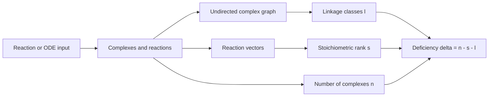

# Scientific Methods

This document specifies the Chemical Reaction Network Theory conventions used
by `crntanalysis`. It describes how reaction and ODE inputs become complexes,
graphs, stoichiometric subspaces, linkage classes, and deficiencies.

## Contents

- [Chemical reaction networks](#chemical-reaction-networks)
- [Complex indexing and reaction graph](#complex-indexing-and-reaction-graph)
- [Weighted undirected adjacency](#weighted-undirected-adjacency)
- [Deterministic mass-action kinetics](#deterministic-mass-action-kinetics)
- [Canonical realization of ODE input](#canonical-realization-of-ode-input)
- [Stoichiometric subspace](#stoichiometric-subspace)
- [Linkage classes](#linkage-classes)
- [Whole-network deficiency](#whole-network-deficiency)
- [Linkage-class deficiency](#linkage-class-deficiency)
- [Symbolic coefficients](#symbolic-coefficients)
- [Example calculation](#example-calculation)
- [Reference](#reference)

## Method overview



## Chemical reaction networks

A chemical reaction network consists of a finite species set, a finite set of
complexes, and directed reactions between complexes. A complex is a formal
nonnegative linear combination of species. For example,

```text
2 X + 3 Y
```

has complex vector `(2, 3)` in species order `(X, Y)`. The zero complex `0` is
represented by the empty species mapping and is a valid graph node.

A reaction (y \rightarrow y') has reaction vector

\[
v = y' - y.
\]

Complex identity is determined by species and resolved stoichiometric
coefficients, not by formatting or the order in which terms were written.

## Complex indexing and reaction graph

Distinct complexes receive zero-based indices in first-appearance order. A
reaction stores the source and target indices rather than copying the complex
vectors.

The reaction graph is directed: every reaction is an edge from its reactant
complex to its product complex. Rate constants are edge weights for reporting
and kinetic interpretation, but they do not affect deficiency.

## Weighted undirected adjacency

Linkage is based on the underlying undirected complex graph. The returned
weighted adjacency matrix is symmetric and uses:

- `0` when no reaction connects two complexes;
- a positive number when one path has a resolved rate value;
- a symbol such as `"k1"` when one path has an unresolved rate;
- a list when parallel or oppositely directed paths connect the same pair.

Direction is retained in the reaction list, not in this symmetric matrix.
Deficiency calculation derives connectivity from reaction endpoints, so it does
not depend on matrix value types.

## Deterministic mass-action kinetics

For reaction \(\rho\) with reactant vector \(r_\rho\), product vector
\(p_\rho\), and positive rate constant \(k_\rho\), deterministic mass action
assigns the rate

\[
R_\rho(x)=k_\rho\prod_{i=1}^{m}x_i^{r_{\rho i}}.
\]

The species dynamics are

\[
\frac{dx}{dt}
=\sum_{\rho\in\mathcal R}(p_\rho-r_\rho)R_\rho(x).
\]

Therefore, a rate monomial determines a reactant complex, while its signed
coefficients across species equations determine the reaction vector.

## Canonical realization of ODE input

Recovering a reaction network from ODEs is not unique in general. This project
uses a deterministic canonical convention:

1. Parse every signed `rate_constant * concentration_monomial` contribution.
2. Treat monomial exponents as the reactant complex.
3. Group contributions having the same rate constant and reactant monomial.
4. Combine their signed integer multipliers into one reaction vector.
5. Add the reaction vector to the reactant to obtain the product complex.
6. Reject the realization if a product coefficient becomes negative.

Mass-action exponents must be nonnegative integers after supplied coefficient
values are resolved. A negative term for species `X` is admissible only if its
reactant monomial contains enough `X` to support that consumption.

For example,

```text
dx/dt = k1 * X^2 * Y
dy/dt = -k1 * X^2 * Y
```

is canonically realized as

```text
2 X + Y -> 3 X
```

with rate constant `k1`.

The provided `Example_Data/crn2.ode` does not pass ordinary mass-action
validation. Its `k2 * A^3 * B^2` contribution consumes `X`, although `X` is
absent from that reactant monomial. The parser rejects this rather than silently
constructing a generalized-kinetics network.

## Stoichiometric subspace

Let the reaction vectors be

\[
v_\rho=y'_\rho-y_\rho.
\]

The stoichiometric subspace is their linear span. Its dimension `s` is the rank
of the matrix whose rows are the reaction vectors in a consistent species
ordering.

The calculation uses exact SymPy rationals for numerical coefficients. It does
not use floating-point tolerance to determine rank.

## Linkage classes

A linkage class is a connected component of the underlying undirected complex
graph. Reaction direction and rate values are ignored when determining these
components. An isolated complex is one linkage class by itself.

The implementation finds linkage classes using union-find over complex indices
and reaction endpoints.

## Whole-network deficiency

The standard network deficiency is

\[
\delta=n-s-\ell,
\]

where:

- `n` is the number of distinct complexes;
- `s` is the dimension of the global stoichiometric subspace;
- `l` is the number of linkage classes.

The global rank is calculated from all reaction vectors together.

## Linkage-class deficiency

For linkage class \(i\), the project restricts attention to its complexes and
reactions and calculates

\[
\delta_i=n_i-s_i-1.
\]

Here, `n_i` is the number of complexes in that class and `s_i` is the rank of
the reaction vectors belonging to the class. The linkage count is one by
construction.

The global stoichiometric rank must not be replaced by the sum of the class
ranks. Stoichiometric subspaces belonging to different linkage classes can
overlap. Consequently, the global deficiency need not equal the sum of the
linkage-class deficiencies.

## Symbolic coefficients

Missing rate constants do not affect structural deficiency and may remain
symbolic.

Missing stoichiometric coefficients affect complex identity and reaction-vector
rank. Three parser policies are available:

- `symbolic`: retain the unresolved symbol;
- `error`: reject any unresolved value;
- `one`: substitute `1.0` explicitly.

With symbolic stoichiometry, SymPy calculates a generic symbolic rank. The
result is marked with `symbolic_rank=True`. Special parameter values or
relations between parameters can reduce the rank, merge complexes, or change
the deficiency. Use resolved values when a parameter-specific deficiency is
required.

## Example calculation

For `Example_Data/crn1.react`, the implementation obtains:

```text
n = 11
s = 4
l = 5
delta = 2
```

The five linkage-class deficiencies are:

```text
[0, 0, 0, 1, 0]
```

This example also demonstrates why class deficiencies should be reported
alongside, but not substituted for, the whole-network deficiency.

## Reference

The deterministic mass-action convention follows the CRN semantics summarized
in Section 2 of:

X. Huang, T. H. Klinge, J. I. Lathrop, X. Li, and J. H. Lutz,
“Real-Time Computability of Real Numbers by Chemical Reaction Networks,”
[arXiv:1803.10267](https://arxiv.org/abs/1803.10267).
